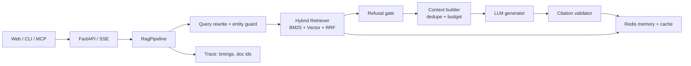

# wzry-rag

[English](README.md) | [中文](README.zh-CN.md)

**Evaluation-driven RAG + MCP knowledge service for Honor of Kings (王者荣耀).**

A small, end-to-end vertical RAG project: crawl → clean → chunk → hybrid retrieval → grounded generation → citations → multi-turn memory → streaming API → MCP tools. The emphasis is not "another chatbot", but **measurable retrieval decisions and failure analysis**.

> Knowledge snapshot: **2016**. The game data is a frozen snapshot used to make the retrieval experiments reproducible. It is not a live game database.

---

## Why this project

Most RAG demos stop at "vector search + LLM". This project keeps the parts that decide whether a RAG system is trustworthy:

- **Hybrid retrieval** (BM25 + vector + RRF) with a measured gain over the vector baseline.
- **Evaluation-driven iteration**: an 80-question stratified set, a historical 3×3 chunking/retrieval ablation, and a documented negative result for reranking.
- **Grounded answers**: refusal gate, citation ids, citation validation, and a prompt that forbids unsupported tactics/combo advice.
- **Multi-turn context**: query rewriting with entity-preservation fallback, Redis summary memory, and versioned answer cache.
- **MCP server**: retrieval is exposed as tools so external agents can call it.
- **Traceable requests**: non-cached answers return rewrite/retrieve/generate timings and retrieved doc ids; cached answers return a cache-hit trace.

---

## Architecture



The important design choice: **API, CLI and MCP go through one `pipeline.py`**. Evaluation is intentionally a retrieval-only harness that reuses the same retriever and answer prompt, but skips streaming, session memory, cache and refusal so those layers do not contaminate retrieval metrics. The earlier code had separate orchestration paths and different prompts, which made evaluation and production drift apart.

---

## Results

Dataset v2: 80 questions (25 mechanics / 20 items / 15 slang / 12 lore / 8 refusal), 72 answerable. Each answerable question has a **question-specific gold doc id**, not the whole hero's document set. Chunking: semantic per-document. K=5. Generation: Qwen2.5-7B-Instruct. Full per-question outputs are kept out of the repository.

| Retriever (doc-level) | Hit@1 | Hit@3 | Hit@5 | Recall@5 | MRR |
|---|---:|---:|---:|---:|---:|
| Vector baseline | 0.764 | 0.819 | 0.833 | 0.833 | 0.795 |
| **Hybrid (BM25 + Vector + RRF)** | **0.792** | **0.958** | **0.986** | **0.986** | **0.867** |
| Hybrid + bge reranker | 0.861 | 0.917 | 0.917 | 0.917 | 0.887 |

Key findings:

- The old subject-level Hit@5 was 0.986; the doc-level v2 Hit@5 is still 0.986, but **Hit@1 is 0.792** and MRR is 0.867. The leakage was in "retrieved this hero" vs "retrieved the requested skill", not in Top5 coverage.
- The old "Recall@5 = 0.567" was hit density (same-subject chunks / K), not recall. The corrected one-gold Recall@5 is 0.986.
- Reranking was rejected for the production Top5 after three runs: it improves Hit@1 (0.861) but loses Hit@5 (0.917 vs 0.986). The root cause is documented; the negative result is kept.
- Slang is **in-vocabulary** (same dictionary used for expansion); 1.00 means the dictionary path works, not that it generalizes to unseen slang.

> Methodology, hard negatives, and validity caveats: [`docs/evaluation.md`](docs/evaluation.md).

---

## Quickstart

### 1. Install

```bash
cp .env.example .env
# edit .env: set EMBED_API_KEY
uv sync --extra dev
# optional RAGAS stack: uv sync --extra eval
```

### 2. Build chunks and index

```bash
make chunks
make index
```

`make index` calls the embedding API and writes `chroma_db/`. The index is intentionally **not committed** (20MB binary + reproducible from chunks).

### 3. Run the API / web demo

```bash
make dev
# open http://localhost:8000/web/
```

### 4. CLI

```bash
uv run python -m agent.generate
```

### 5. Docker (Redis + app)

```bash
docker compose up --build
```

The container mounts `./chroma_db`, so run `make index` once on the host first.

---

## MCP

```bash
# Local stdio (Claude Desktop / Cursor)
MCP_TRANSPORT=stdio uv run python -m mcp_server.server

# Remote SSE
MCP_TRANSPORT=sse uv run python -m mcp_server.server
```

Tools:

- `search_knowledge(query, k=5, type=None)`
- `get_hero(name)`
- `get_item(name)`

Every hit returns `doc_id`, `subject`, `type`, `text`, `source_url`, `score`. See [`docs/mcp.md`](docs/mcp.md) for a client config example.

---

## Design decisions

### Why semantic chunks + hybrid retrieval?

Semantic chunks keep one knowledge item per chunk and preserve complete metadata for citations. BM25 handles exact item/hero names; vectors handle paraphrases and slang. RRF fuses ranks without score calibration. The historical 3×3 ablation is in [`docs/evaluation.md`](docs/evaluation.md), with its measurement caveats.

### Why not rerank in production?

Three runs did not beat hybrid retrieval. The failure was diagnosed as query-expansion text polluting the cross-encoder, not "rerank is useless". The component remains behind `RETRIEVER=rerank` for future experiments.

### Why is query rewriting guarded?

A 7B rewriter sometimes answered instead of rewriting, or replaced the user's new entity with the previous topic. The fix is deliberately boring: rewrite prompt only rewrites, then a programmatic entity-preservation check falls back to the original question.

### Why version the cache?

Cache keys include `index_version`, `prompt_version`, model and K. Without that, changing a prompt or rebuilding the index can serve stale answers for an hour. Cached answers also store citations, so a cache hit still shows sources.

### Why MCP?

The retriever is useful outside the web UI. MCP exposes it to MCP clients with a stable tool schema and keeps provenance fields. The local stdio config is in [`docs/mcp.md`](docs/mcp.md); Claude Desktop/Cursor end-to-end integration is manual, not CI-tested.

---

## Project layout

```text
pipeline.py              # single orchestration entry
contracts.py             # RetrievedChunk / Citation / AnswerResult
config.py                # env-driven settings
api/                     # FastAPI + SSE
retrieval/               # vector, BM25, RRF, rerank experiment
memory/                  # Redis session summary + versioned cache
mcp_server/              # MCP tools
ingest/                  # chunking + Chroma upsert
eval/                    # 80-question eval set + scripts
prompts/                 # versioned prompts
web/                     # minimal streaming demo
tests/                   # unit tests
docs/                    # design / evaluation / MCP notes
```

---

## Limitations

- Data is a **2016 snapshot**; many current heroes/items are missing. The project is a retrieval/engineering demo, not a current-game encyclopedia.
- Evaluation is 80 questions and uses question-specific gold docs; confidence intervals and human calibration are future work.
- Generation uses a 7B API model. Known failure modes include occasional over-refusal and weak false-premise handling; the per-question bad-case notes are kept local.
- No production traffic, auth, or rate limiting. The demo is not hardened for public multi-tenant use.
- MCP tools are manually smoke-tested; Claude Desktop/Cursor end-to-end integration is not part of CI.
- Raw evaluation outputs and per-question analysis are kept local; the repository publishes aggregate results only.

---

## Data & license

Code is MIT licensed. **Game data is not covered by the MIT license**: Honor of Kings and its data belong to Tencent. This repository is a non-commercial technical demo. See `LICENSE` for the data disclaimer. If you are a rights holder and want content removed, please open an issue.

---

## Acknowledgements

Built with FastAPI, Chroma, BM25 (rank-bm25), jieba, OpenAI-compatible APIs, Redis and MCP.
