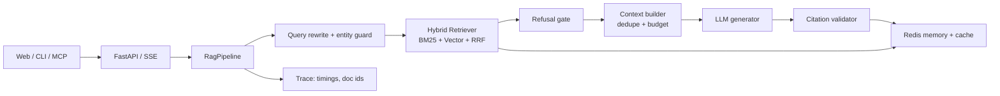

# wzry-rag

**Evaluation-driven RAG + MCP knowledge service for Honor of Kings (王者荣耀).**

A small, end-to-end vertical RAG project: crawl → clean → chunk → hybrid retrieval → grounded generation → citations → multi-turn memory → streaming API → MCP tools. The emphasis is not "another chatbot", but **measurable retrieval decisions and failure analysis**.

> Knowledge snapshot: **2016**. The game data is a frozen snapshot used to make the retrieval experiments reproducible. It is not a live game database.

---

## Why this project

Most RAG demos stop at "vector search + LLM". This project keeps the parts that decide whether a RAG system is trustworthy:

- **Hybrid retrieval** (BM25 + vector + RRF) with a measured gain over the vector baseline.
- **Evaluation-driven iteration**: an 80-question stratified set, a 3×3 chunking/retrieval ablation, and a documented negative result for reranking.
- **Grounded answers**: refusal gate, citation ids, citation validation, and a prompt that forbids unsupported tactics/combo advice.
- **Multi-turn context**: query rewriting with entity-preservation fallback, Redis summary memory, and versioned answer cache.
- **MCP server**: retrieval is exposed as tools so external agents can call it.
- **Traceable requests**: every answer returns rewrite/retrieve/generate timings and retrieved doc ids.

---

## Architecture



The important design choice: **API, CLI, MCP and evaluation go through one `pipeline.py`**. The earlier code had separate orchestration paths, which made evaluation and production drift apart.

---

## Results

Dataset: 80 questions (25 mechanics / 20 items / 15 slang / 12 lore / 8 refusal), 72 answerable questions. Chunking: semantic per-document. K=5. Generation: Qwen2.5-7B-Instruct. Full per-question outputs are kept out of the repository.

| Retriever | Hit@5 | Recall@5 | MRR |
|---|---:|---:|---:|
| Vector baseline | 0.861 | 0.475 | 0.847 |
| **Hybrid (BM25 + Vector + RRF)** | **0.986** | **0.567** | **0.910** |
| Hybrid + bge reranker | 0.917 | 0.486 | 0.894 |

Key findings:

- Slang retrieval improved from **0.60 → 1.00** Hit@5 with hybrid retrieval; the latest run also gains from case-insensitive slang expansion (0.986 overall).
- Reranking was rejected after three independent runs. The likely cause: query expansion text polluted the cross-encoder input. The negative result is kept, not hidden.
- Mechanics/lore questions were already strong on vector search; the hard cases were slang and item names.

> Metric caveat: Hit@5 is a subject-level proxy, not a strict document-level gold metric. See [`docs/evaluation.md`](docs/evaluation.md) for methodology and limitations.

---

## Quickstart

### 1. Install

```bash
cp .env.example .env
# edit .env: set EMBED_API_KEY
uv sync --extra dev
```

### 2. Build chunks and index

```bash
make chunks
make index
```

`make index` calls the embedding API and writes `chroma_db/`. The index is intentionally **not committed** (20MB binary + reproducible from chunks).

### 3. Run the API / web demo

```bash
make dev
# open http://localhost:8000/web/
```

### 4. CLI

```bash
uv run python -m agent.generate
```

### 5. Docker (Redis + app)

```bash
docker compose up --build
```

The container mounts `./chroma_db`, so run `make index` once on the host first.

---

## MCP

```bash
# Local stdio (Claude Desktop / Cursor)
MCP_TRANSPORT=stdio uv run python -m mcp_server.server

# Remote SSE
MCP_TRANSPORT=sse uv run python -m mcp_server.server
```

Tools:

- `search_knowledge(query, k=5, type=None)`
- `get_hero(name)`
- `get_item(name)`

Every hit returns `doc_id`, `subject`, `type`, `text`, `source_url`, `score`. See [`docs/mcp.md`](docs/mcp.md) for a client config example.

---

## Design decisions

### Why semantic chunks + hybrid retrieval?

Semantic chunks keep one knowledge item per chunk and preserve complete metadata for citations. BM25 handles exact item/hero names; vectors handle paraphrases and slang. RRF fuses ranks without score calibration. The 3×3 ablation is in [`docs/evaluation.md`](docs/evaluation.md).

### Why not rerank in production?

Three runs did not beat hybrid retrieval. The failure was diagnosed as query-expansion text polluting the cross-encoder, not "rerank is useless". The component remains behind `RETRIEVER=rerank` for future experiments.

### Why is query rewriting guarded?

A 7B rewriter sometimes answered instead of rewriting, or replaced the user's new entity with the previous topic. The fix is deliberately boring: rewrite prompt only rewrites, then a programmatic entity-preservation check falls back to the original question.

### Why version the cache?

Cache keys include `index_version`, `prompt_version`, model and K. Without that, changing a prompt or rebuilding the index can serve stale answers for an hour. Cached answers also store citations, so a cache hit still shows sources.

### Why MCP?

The retriever is useful outside the web UI. MCP makes it callable from Claude Desktop/Cursor/other agents with a stable schema, while keeping provenance fields.

---

## Project layout

```text
pipeline.py              # single orchestration entry
contracts.py             # RetrievedChunk / Citation / AnswerResult
config.py                # env-driven settings
api/                     # FastAPI + SSE
retrieval/               # vector, BM25, RRF, rerank experiment
memory/                  # Redis session summary + versioned cache
mcp_server/              # MCP tools
ingest/                  # chunking + Chroma upsert
eval/                    # 80-question eval set + scripts
prompts/                 # versioned prompts
web/                     # minimal streaming demo
tests/                   # unit tests
docs/                    # design / evaluation / MCP notes
```

---

## Limitations

- Data is a **2016 snapshot**; many current heroes/items are missing. The project is a retrieval/engineering demo, not a current-game encyclopedia.
- Evaluation is 80 questions and uses a subject-level Hit proxy; confidence intervals and human calibration are future work.
- Generation uses a 7B API model. Failure modes such as occasional over-refusal and false-premise handling are documented in the bad-case notes.
- No production traffic, auth, or rate limiting. The demo is not hardened for public multi-tenant use.
- Raw evaluation outputs and per-question analysis are kept local; the repository publishes aggregate results only.

---

## Data & license

Code is MIT licensed. **Game data is not covered by the MIT license**: Honor of Kings and its data belong to Tencent. This repository is a non-commercial technical demo. See `LICENSE` for the data disclaimer. If you are a rights holder and want content removed, please open an issue.

---

## Acknowledgements

Built with FastAPI, Chroma, BM25 (rank-bm25), jieba, OpenAI-compatible APIs, Redis and MCP.
