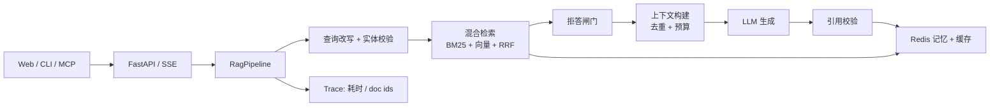

# wzry-rag

**面向王者荣耀的评测驱动 RAG + MCP 知识服务**

[English](README.md)

一个端到端的垂直领域 RAG 项目：采集 → 清洗 → 分块 → 混合检索 → 有依据生成 → 引用 → 多轮记忆 → 流式 API → MCP 工具。  
重点不是“再做一个聊天机器人”，而是**可量化的检索决策和失败分析**。

> 知识库是 **2016 快照**：用于让检索实验可复现，不代表当前游戏全量数据。

---

## 为什么做这个项目

大多数 RAG demo 停在“向量检索 + LLM”。这个项目保留真正决定 RAG 是否可信的部分：

- **混合检索**：BM25 + 向量 + RRF，相比纯向量有实际提升。
- **评测驱动**：80 条分层问题、历史 3×3 分块/检索消融、一次被记录下来的 rerank 负结果。
- **有依据回答**：拒答闸门、引用编号、引用校验，prompt 明确禁止编造连招/打法。
- **多轮上下文**：查询改写 + 实体保真回退、Redis 分层摘要、版本化答案缓存。
- **MCP 工具**：检索能力可以被 Claude Desktop / Cursor 等 MCP 客户端调用。
- **可追踪**：非缓存回答返回改写/检索/生成耗时和检索到的 doc id；缓存命中返回 cache trace。

---

## 架构



设计取舍：**API、CLI、MCP 走同一个 `pipeline.py`**。  
评测是独立的 retrieval-only harness：复用同一套 retriever 和 answer prompt，但不走流式、会话记忆、缓存和拒答，避免这些层污染检索指标。

---

## 评测结果

数据集 v2：80 条问题（机制 25 / 装备 20 / 黑话 15 / 背景 12 / 拒答 8），其中 72 条有答案。  
每个有答案的问题都有**题目级 gold doc id**，不是把整个英雄的文档都挂上去。分块：semantic per-document。K=5。生成：Qwen2.5-7B-Instruct。

| 检索器（doc-level） | Hit@1 | Hit@3 | Hit@5 | Recall@5 | MRR |
|---|---:|---:|---:|---:|---:|
| 纯向量 | 0.764 | 0.819 | 0.833 | 0.833 | 0.795 |
| **混合（BM25 + 向量 + RRF）** | **0.792** | **0.958** | **0.986** | **0.986** | **0.867** |
| 混合 + bge reranker | 0.861 | 0.917 | 0.917 | 0.917 | 0.887 |

关键发现：

- 旧 subject-level Hit@5 是 0.986；换成题目级 gold 后 Hit@5 仍是 0.986，但 **Hit@1 只有 0.792，MRR 0.867**。  
  真正的泄漏是“召回到这个英雄”不等于“召回到题目问的技能”，不是 Top5 覆盖。
- 旧 “Recall@5 = 0.567” 是 Top5 中同 subject 的占比，不是 Recall；修正后的单 gold Recall@5 是 0.986。
- rerank 的 Hit@1 更高（0.861），但 Hit@5 下降到 0.917，所以生产 Top5 仍用 hybrid；这是有记录的负结果。
- 黑话是 **in-vocabulary**：题目和 query expansion 共用同一份词典，1.00 只说明词典路径有效，不代表未见黑话的泛化。

> 方法论、hard negative 和已知局限见 [`docs/evaluation.md`](docs/evaluation.md)。

---

## 快速开始

### 1. 安装

```bash
cp .env.example .env
# 编辑 .env，至少设置 EMBED_API_KEY
uv sync --extra dev
# 可选：跑 RAGAS 时再装
# uv sync --extra eval
```

### 2. 建分块和索引

```bash
make chunks
make index
```

`make index` 会调用 embedding API，并写入 `chroma_db/`。索引不入库，靠 `make index` 复现。

### 3. 启动 API / Web demo

```bash
make dev
# 打开 http://localhost:8000/web/
```

### 4. CLI

```bash
uv run python -m agent.generate
```

### 5. Docker（Redis + app）

```bash
docker compose up --build
```

容器会挂载 `./chroma_db`，所以先在宿主机跑一次 `make index`。

---

## MCP

```bash
# 本地 stdio：Claude Desktop / Cursor
MCP_TRANSPORT=stdio uv run python -m mcp_server.server

# 远程 SSE
MCP_TRANSPORT=sse uv run python -m mcp_server.server
```

工具：

- `search_knowledge(query, k=5, type=None)`
- `get_hero(name)`
- `get_item(name)`

每个结果都带 `doc_id / subject / type / text / source_url / score`。客户端配置见 [`docs/mcp.md`](docs/mcp.md)。  
MCP 工具做过手动 smoke test；Claude Desktop/Cursor 端到端联调不在 CI 里。

---

## 设计取舍

### 为什么 semantic 分块 + 混合检索？

semantic 分块一条知识一个 chunk，元数据完整，引用能回到具体 doc_id。  
BM25 负责英雄/装备专名和黑话，向量负责语义改写，RRF 只按名次融合，不需要分数归一化。  
历史 3×3 消融和判据 caveat 见 [`docs/evaluation.md`](docs/evaluation.md)。

### 为什么 rerank 没上线？

三次独立评估都没有超过 hybrid 的 Top5。已定位的原因：query expansion 文本污染了 rerank 候选池——粗排用了扩展 query，cross-encoder 看的是原始 query。  
组件保留在 `RETRIEVER=rerank`，但这是一个有记录的负结果，不是“rerank 永远没用”。

### 为什么改写要加实体校验？

7B 改写器会做两件坏事：把答案写进查询；把用户新提出的实体替换成上一轮实体。  
修法很朴素：改写 prompt 只做改写；代码检查原问题实体是否还在改写结果里，不在就回退原文。

### 为什么缓存要带版本？

cache key 包含 `index_version / prompt_version / model / K`。  
否则改 prompt 或重建索引后，1 小时内可能拿到旧答案。缓存值同时存 answer 和 citations，命中缓存也显示来源。

### 为什么做 MCP？

检索能力不只服务 Web UI。MCP 让它以稳定 schema 被外部 Agent 调用，并保留 provenance 字段。

---

## 目录

```text
pipeline.py              # 唯一编排入口
contracts.py             # RetrievedChunk / Citation / AnswerResult
config.py                # 环境配置
api/                     # FastAPI + SSE
retrieval/               # 向量、BM25、RRF、rerank 实验
memory/                  # Redis 会话摘要 + 版本化缓存
mcp_server/              # MCP 工具
ingest/                  # 分块 + Chroma upsert
eval/                    # 80 条评测集 + 脚本
prompts/                 # 版本化 prompt
web/                     # 最小流式 demo
tests/                   # 单测
docs/                    # 设计 / 评测 / MCP 文档
```

---

## 局限

- 数据是 **2016 快照**，缺很多当前英雄/装备；这是一个检索/工程 demo，不是当前游戏百科。
- 评测只有 80 条，且没有置信区间和人工校准；72 条有答案题偏小。
- 生成用 7B API 模型，偶发过度拒答、错误前提处理弱；逐题 bad case 笔记留在本地。
- 没有真实流量、鉴权、限流；公网多租户场景没有加固。
- MCP 工具手动 smoke test；Claude Desktop/Cursor 端到端不在 CI。
- 逐题评测结果和本地分析不公开；仓库只放聚合结果。

---

## 数据与许可证

代码使用 MIT License。  
**游戏数据不包含在 MIT 许可证内**：王者荣耀及数据归腾讯所有，本项目仅用于非商业技术演示。  
如果权利方希望移除内容，请开 issue。详见 `LICENSE`。

---

## 致谢

FastAPI、Chroma、BM25（rank-bm25）、jieba、OpenAI-compatible API、Redis、MCP。
