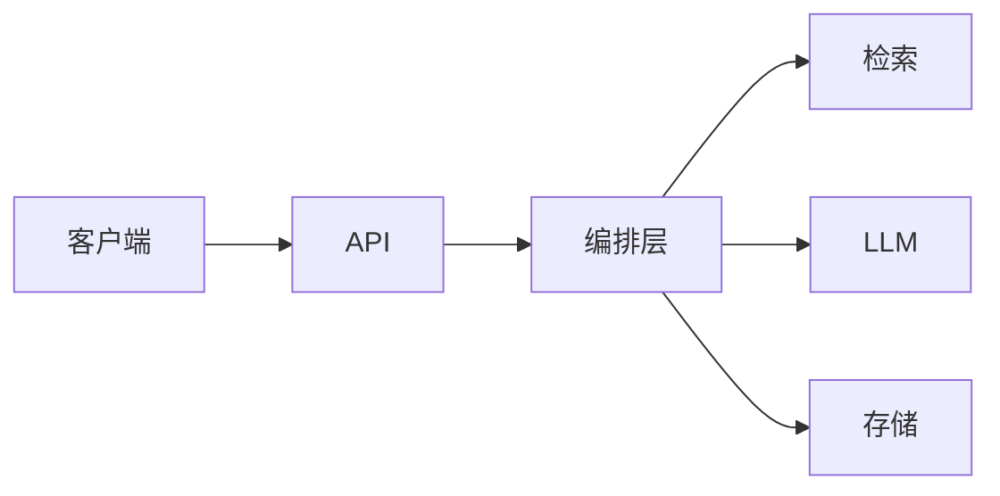

# {项目名}

> {一句话定位：给谁解决什么问题，不要写“基于大模型的智能平台”}

{可选：demo 截图 / GIF / 在线地址}

## 项目背景

- 问题：{现有方案哪里不够好}
- 目标：{你具体要优化什么}
- 边界：{不做什么，避免过度承诺}

## 核心能力

- {能力 1：一句话 + 可验证结果}
- {能力 2：一句话 + 可验证结果}
- {能力 3：一句话 + 可验证结果}

## 架构



关键设计取舍：{为什么这样分层 / 为什么不引入某个组件}

## 评测结果

数据集：{规模、来源、类别、标注方式}  
指标：{Hit@k / Recall / MRR /  faithfulness / latency / cost}  
基线：{baseline 配置}  
本方案：{配置}

| 指标 | 基线 | 本方案 | 变化 |
|---|---:|---:|---:|
| {指标 1} | {值} | {值} | {变化} |
| {指标 2} | {值} | {值} | {变化} |

结论：

- {提升来自哪里}
- {哪个方案被否决，为什么}
- {指标口径的局限}

## 快速开始

```bash
cp .env.example .env
# 填写必要配置
uv sync
make index     # 或对应初始化命令
make dev
```

## 设计取舍

### 为什么选 {方案 A} 而不是 {方案 B}？

{用数据/约束回答，不要只写“因为更先进”}

### 为什么没有上 {方案 C}？

{负结果也要写；说明根因和回滚}

### {关键工程问题} 怎么处理？

{错误处理、缓存、版本、回滚、可观测性}

## 目录结构

```text
{目录}    # {职责}
```

## 局限

- {数据规模 / 数据版本}
- {评测口径 / 样本量}
- {模型能力边界}
- {未验证的集成}
- {不适合的场景}

## 数据与许可证

- 代码：{MIT / Apache-2.0}
- 数据：{来源、版权、是否随仓库分发}
- 免责声明：{如有第三方数据，写清楚}

## 写作原则

- 只写代码和评测能证明的内容；不要写“生产级 / SOTA / 多 Agent 生产系统”。
- 所有数字必须能由仓库脚本复现；不能复现的写“离线实验”或“历史结果”。
- 负结果、失败案例、指标 caveat 要主动写；面试官更看重判断力。
- README 里的命令要和 Makefile / Dockerfile / 实际入口一致。
